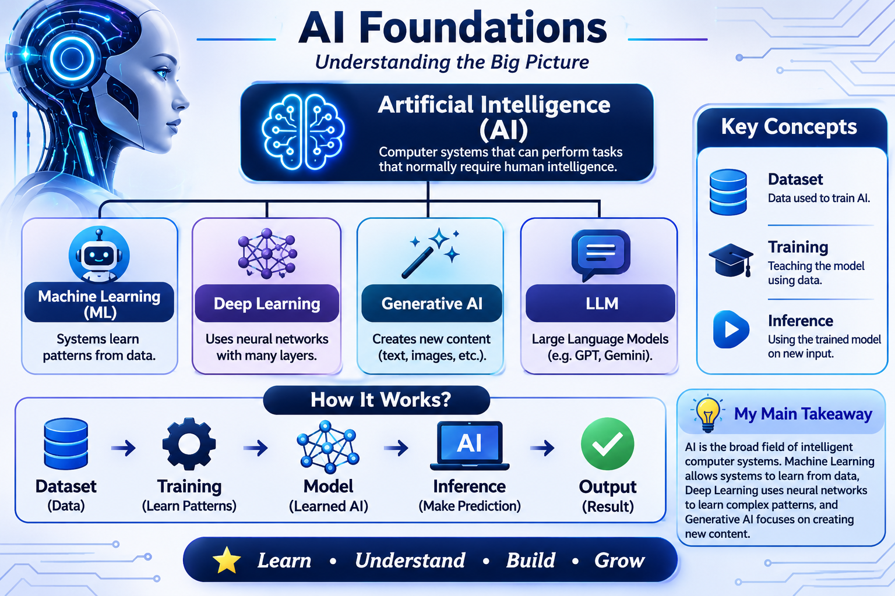

AI Foundations 

The fundamental concepts of Artificial Intelligence and how they are connected.

1. Artificial Intelligence (AI)

Artificial Intelligence is the broad field of creating computer systems that can perform tasks that normally require human intelligence.

Examples include understanding language, recognizing images, making predictions, and generating content.

2. Machine Learning (ML)

Machine Learning is a branch of AI where systems learn patterns from data instead of being explicitly programmed with every rule.

3. Deep Learning

Deep Learning is a type of Machine Learning that uses neural networks with multiple layers to learn complex patterns from data.

4. Generative AI

Generative AI refers to AI systems that can create new content such as text, images, audio, video, and code.

5. Large Language Models (LLMs)

LLMs are AI models trained on large amounts of language data to understand and generate human language.

Examples include GPT, Gemini, Claude, and Llama.

6. Dataset

A dataset is a collection of data used to train, evaluate, or work with an AI model.

Datasets can contain text, images, audio, video, or numerical data.

7. Training

Training is the process through which an AI model learns patterns from data.

8. Inference

Inference is when a trained model uses what it has learned to produce an output from new input.

How These Concepts Connect

Artificial Intelligence
        │
        └── Machine Learning
                │
                └── Deep Learning
                        │
                        └── Neural Networks

Generative AI focuses on creating new content, while LLMs specialize in understanding and generating language.

How AI Works

Dataset
   ↓
Training
   ↓
Model
   ↓
Inference
   ↓
Output

My Main Takeaway

AI is the broad field of intelligent computer systems. Machine Learning allows systems to learn from data, while Deep Learning uses neural networks to learn complex patterns. Generative AI focuses on creating new content, and LLMs specialize in language.
