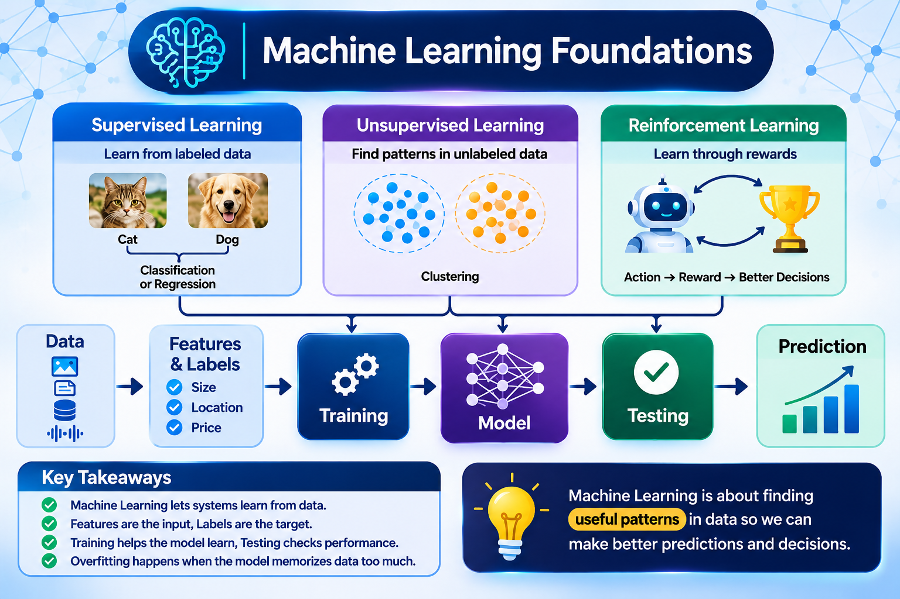

# Machine Learning Foundations 

## Overview


## 1. What is Machine Learning?

Machine Learning is a branch of AI that allows computers to learn patterns from data and use those patterns to make predictions or decisions.

In traditional programming, we usually define the rules ourselves. With machine learning, we provide data and examples, and the model learns useful patterns from them.

For example, a model designed to distinguish cats from dogs could be trained using many labeled images:

```text
Image 1 → Cat
Image 2 → Dog
Image 3 → Cat
Image 4 → Dog
```

Once trained, the model can use what it learned to classify an image it has not seen before.

```text
New Image → Model → Dog
```

The important idea for me is that the model is not simply following a list of manually written rules. It is learning patterns from examples.

---

## 2. Dataset

A dataset is a collection of data used in a machine learning process.

Depending on the problem, a dataset could contain images, text, numbers, audio, video, or other types of information.

For example, a dataset for a cat-and-dog classifier might contain thousands of images:

```text
Dataset
├── Cat image
├── Dog image
├── Cat image
├── Dog image
└── Cat image
```

The quality and structure of the dataset are important because the model learns from the information it is given.

---

## 3. Features

Features are the pieces of information that a model uses as input.

For example, if we want to predict the price of a house, some possible features could be:

```text
Size: 120 m²
Bedrooms: 3
Location: Hargeisa
Age: 5 years
```

The model uses these characteristics to learn relationships that can help it estimate the house price.

So, features can be thought of as the information we give the model before it produces a prediction.

---

## 4. Labels

A label is the target or expected answer associated with an example.

For a house price prediction problem:

```text
Features:
Size = 120 m²
Bedrooms = 3
Location = Hargeisa

Label:
Price = $50,000
```

Here, the features describe the house, while the price is the value we want the model to learn to predict.

For classification, the label could be a category:

```text
Image → Cat
```

In this case, `Cat` is the label.

This gives us a simple relationship:

```text
Features → Model → Label / Prediction
```

---

## 5. Supervised Learning

Supervised Learning is a machine learning approach where the training data includes labels.

The model learns by comparing its predictions with the known answers in the training data.

For example:

```text
Image 1 → Cat
Image 2 → Dog
Image 3 → Cat
Image 4 → Dog
```

After learning from these examples, the model can make a prediction for a new image.

Supervised learning is commonly used for two types of problems:

### Classification

Classification predicts a category.

Examples:

- Spam or not spam
- Cat or dog
- Fraud or not fraud

### Regression

Regression predicts a numerical value.

Examples:

- House prices
- Sales
- Temperature

The main difference is that classification chooses between categories, while regression estimates a number.

---

## 6. Unsupervised Learning

Unsupervised Learning works with data that does not have predefined labels.

Instead of being given the correct answers, the model tries to find useful patterns or structures within the data.

For example, imagine having information about customers and their spending:

```text
Customer A → $20/month
Customer B → $200/month
Customer C → $25/month
Customer D → $250/month
```

We have not told the model which customers belong together. It may discover that some customers have similar spending behavior and group them together.

This type of grouping is known as **clustering**.

Unsupervised learning can therefore be useful when we want to explore a dataset and discover patterns that were not explicitly defined beforehand.

---

## 7. Reinforcement Learning

Reinforcement Learning takes a different approach.

Instead of learning from labeled examples, an agent interacts with an environment and receives feedback based on its actions.

The basic process can be represented as:

```text
Action → Result → Reward / Penalty → Learning
```

For example, an AI agent playing a game might receive a positive reward for making a successful move and a negative reward for making a poor decision.

By repeatedly interacting with the environment, the agent can learn which actions tend to produce better results.

Reinforcement learning is commonly associated with areas such as:

- Robotics
- Games
- Autonomous systems
- Decision-making

---

## 8. Training vs Testing

A machine learning model needs to be trained, but we also need a way to check whether it can work with data it has not seen before.

For this reason, a dataset is often divided into training and testing data.

For example:

```text
1000 Images
│
├── 800 → Training
│
└── 200 → Testing
```

The **training data** is used to help the model learn patterns.

The **testing data** is kept separate and used later to evaluate how the model performs on unseen examples.

This distinction is important because a model that performs well on data it has already seen is not necessarily a model that will perform well in the real world.

---

## 9. Overfitting

One of the problems a machine learning model can face is **overfitting**.

Overfitting happens when a model becomes too focused on the training data. Instead of learning general patterns, it may effectively memorize details from the examples it was trained on.

A simple analogy is a student who memorizes the answers to an old exam without understanding the subject. The student may perform very well when given the same questions, but struggle when the questions are changed.

The same idea applies to machine learning:

```text
Training Data
      ↓
Model learns too specifically
      ↓
Very good training performance
      ↓
Poor performance on new data
```

A useful model should instead learn patterns that **generalize** to new examples.

---

# How the Concepts Connect

The main ideas from this lesson fit together like this:

```text
                 MACHINE LEARNING
                        │
        ┌───────────────┼───────────────┐
        │               │               │
   Supervised      Unsupervised   Reinforcement
        │               │               │
  Labeled Data    Unlabeled Data    Rewards
        │               │               │
        └───────────────┼───────────────┘
                        │
                     Training
                        │
                      Model
                        │
                     Testing
                        │
                  New Data
                        │
                   Prediction
```

---

